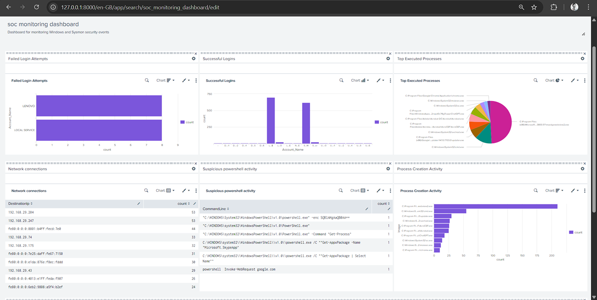
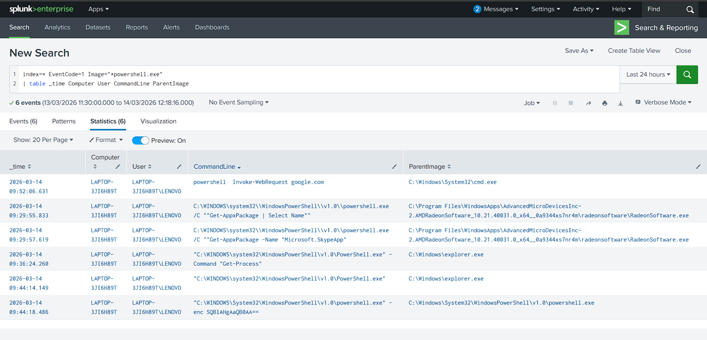
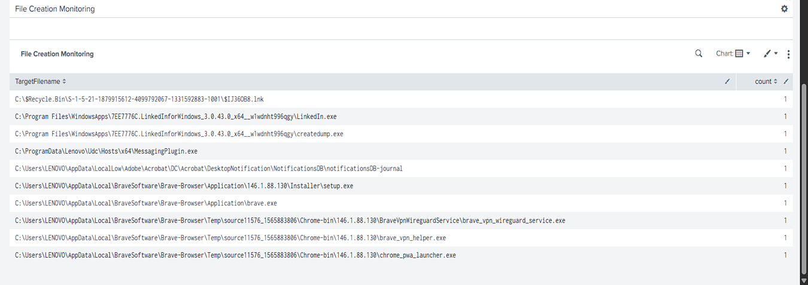
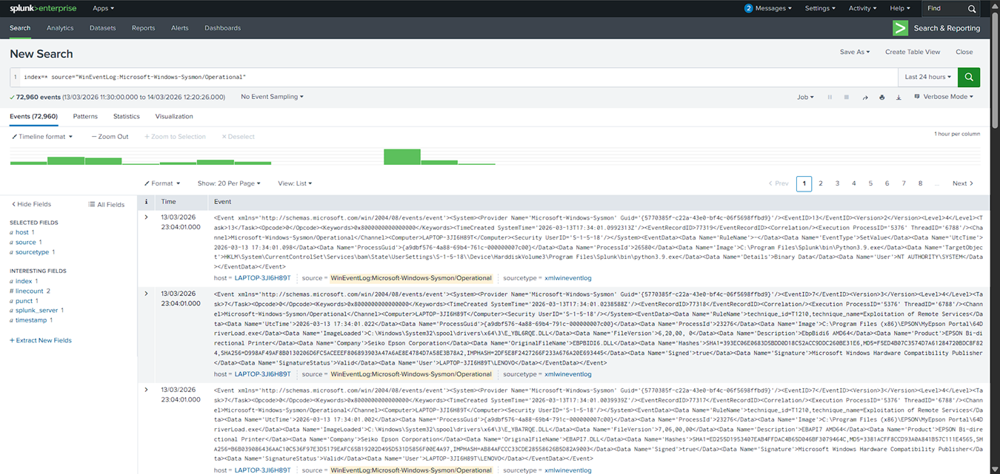

# 👨‍💻 Vignesh Kilambi

### 🔍 Splunk SOC Monitoring Home Lab

This project demonstrates continuous security monitoring using **Splunk SIEM** and **Sysmon logs** to detect suspicious activities on a Windows system.

---

## 🏗️ Lab Overview

The lab consists of:

* **Windows Machine (Monitored System)**
* **Splunk SIEM (Log Analysis & Monitoring)**
* **Sysmon (Event Logging)**

---

## 📊 SOC Monitoring Dashboard

A dashboard was created in Splunk to monitor:

* Failed login attempts
* Process execution
* Network activity
* PowerShell usage



---

## ⚡ PowerShell Activity Detection

PowerShell execution was monitored to detect suspicious commands.

### 🔹 Detection Query:

```spl
index=* EventCode=1
| search powershell
| table _time, Image, CommandLine
```

### 🔹 Analysis:

* PowerShell processes were identified from logs
* Command-line arguments analyzed for suspicious behavior



---

## 📁 File Creation Monitoring (Sysmon Event ID 11)

File creation activity was monitored to detect suspicious file drops.

### 🔹 Detection Query:

```spl
index=* EventCode=11
| table _time, TargetFilename, Image
```

### 🔹 Analysis:

* New files created on the system were tracked
* Helps identify potential malware activity



---

## 🔐 Failed Login Detection

Multiple failed login attempts were monitored to detect brute-force attacks.

### 🔹 Detection Query:

```spl
index=wineventlog EventCode=4625
| stats count by Account_Name
| sort - count
```

### 🔹 Analysis:

* Repeated failed login attempts observed
* Indicates possible unauthorized access attempts

---

## 🔍 Sysmon Log Analysis

Sysmon logs were ingested into Splunk to analyze endpoint activity.



---

## 🧠 MITRE ATT&CK Mapping

| Technique            | ID        | Description                        |
| -------------------- | --------- | ---------------------------------- |
| PowerShell Execution | T1059.001 | Command execution via PowerShell   |
| Brute Force          | T1110     | Multiple failed login attempts     |
| File Creation        | T1105     | File creation or transfer activity |

---

## 🛠 Tools Used

* Splunk SIEM
* Sysmon
* Windows

---

## 📁 Project Structure

```
splunk-soc-monitoring-home-lab/
│── images/
│── queries/
│── detections/
│── logs/
│── reports/
│── setup/
│── mitre-mapping/
│── project-files/
```

---

## 📂 Project Files

* Full project PPT available in `project-files/`

---

## 📊 Outcome

* Monitored system activity using SIEM
* Detected PowerShell execution
* Identified file creation events
* Detected failed login attempts
* Gained hands-on SOC monitoring experience

---

## 🎯 Skills Gained

* SIEM Monitoring (Splunk)
* Log Analysis (Sysmon & Windows Logs)
* Threat Detection
* Security Monitoring
* Blue Team Fundamentals

---

## 📌 Author

**Vignesh Kilambi**
Aspiring SOC Analyst
